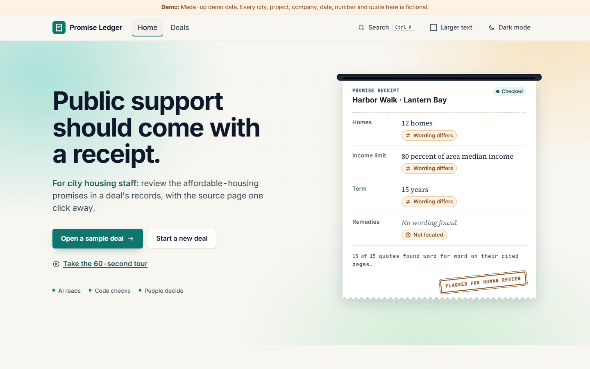
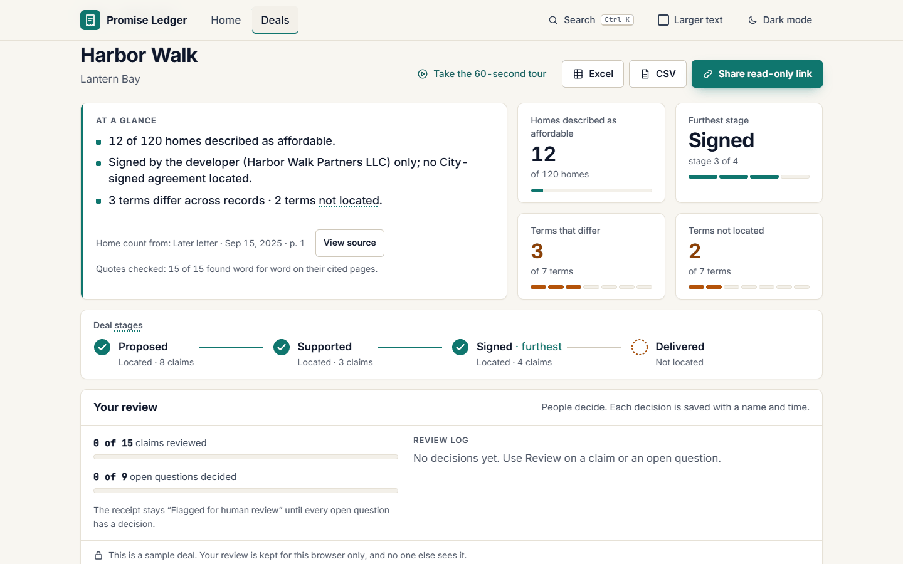
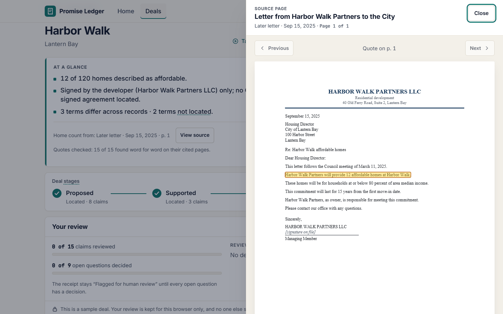
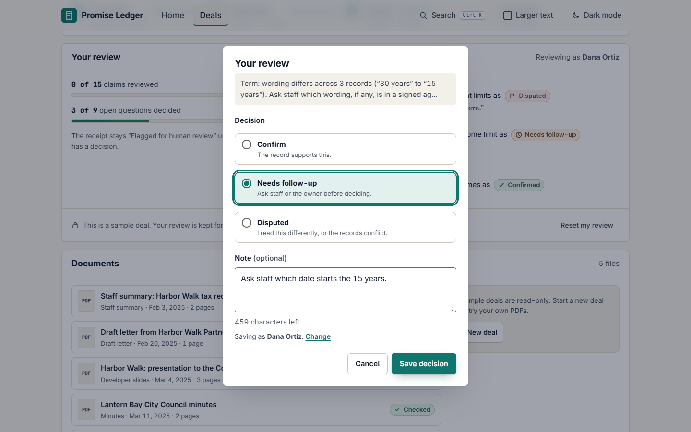
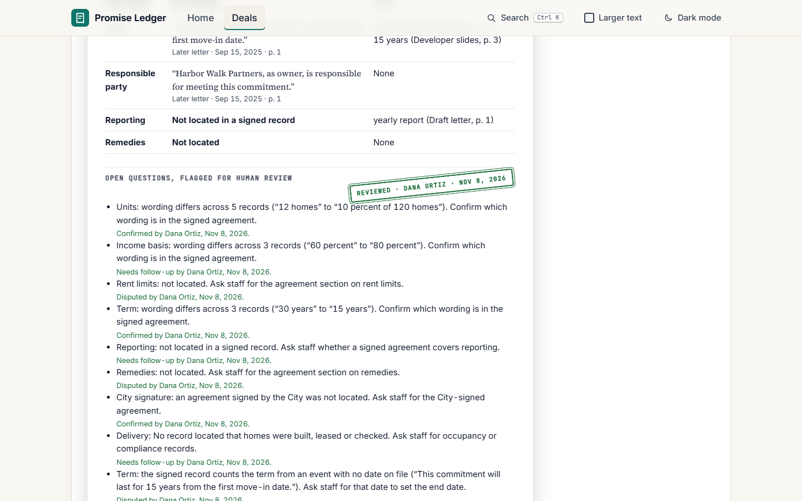
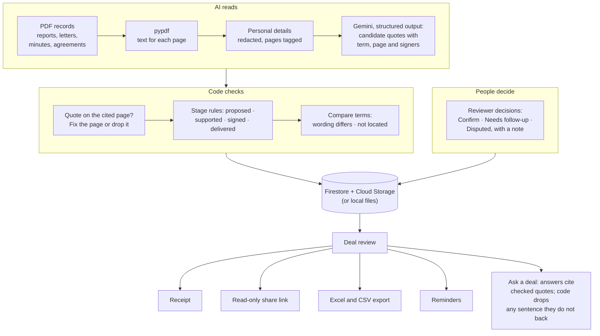
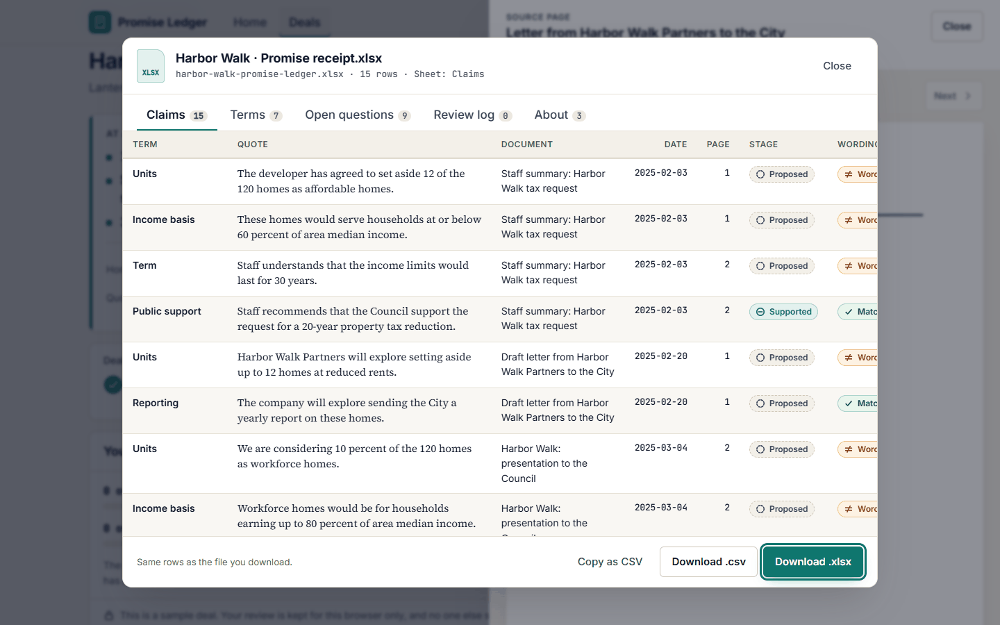

# Promise Ledger

<picture>
  <source media="(prefers-color-scheme: dark)" srcset="docs/images/hero-dark.png">
  
</picture>

**Source-linked receipts for subsidized housing deals.** When a project gets a tax break or other public support, its affordable-housing promises are scattered across staff reports, letters, slides and minutes. Promise Ledger turns those PDFs into one checked receipt: how many homes, for whom, for how long, and the exact page that says so.

**Live demo:** https://promise-ledger-1071927289312.us-central1.run.app (open Harbor Walk, then "Take the 60-second tour")

**Full guide:** [docs/GUIDE.md](docs/GUIDE.md), covering the product, pipeline, AI, stack, evaluation, safety, deployment and API in one place.

For city and county housing staff, compliance officers and council aides. Shared receipts are read-only, so residents can see them too. All data is made up, and nothing here makes legal findings. Built for GDG AI for Good 2026: Housing by Liyue Housing Association, a two-person student team.

<table>
  <tr>
    <td width="50%"><br><b>At a glance.</b> Key figures and how far the deal got: proposed, supported, signed, delivered.</td>
    <td width="50%"><br><b>View source.</b> Every claim opens the real PDF page with the exact quote highlighted.</td>
  </tr>
  <tr>
    <td width="50%"><br><b>People decide.</b> Confirm, ask for follow-up or dispute each item, with a note. Every decision keeps a name and time, and shows in green, amber or red with its own icon.</td>
    <td width="50%"><br><b>Receipt.</b> The stamp states the outcome: "Flagged for human review", then "Review in progress", then "Review complete" with any disputed or follow-up items, and the last reviewer and date beneath it.</td>
  </tr>
</table>

<p align="center"></p>

## How it works



**AI reads · code checks · people decide.** The model only proposes quotes. Code keeps a quote only if it is on the cited page, word for word, and code rules (never the model alone) set each stage. People record the decisions, which sit beside the record and never change a claim, a term or a stage.

<details>
<summary>Pipeline, step by step</summary>

Each uploaded PDF goes through `app/pipeline.py`:

1. The file is stored. Limits: 20 MB, 60 pages, no password.
2. pypdf extracts the text of each page. Pages with no text layer are flagged as scanned. With an API key, the model transcribes up to 10 of them per record word for word; their claims are marked "From scan" and an open question asks a person to check those quotes against the PDF. Scanned pages that were not transcribed are listed as open questions.
3. The model gets the redacted page text, tagged `<page n="1">…`, and returns candidate quotes with term, page, document type and named signers.
4. Code checks every quote against the page text (whitespace, quote marks and dashes normalized). A quote found on another page gets its page corrected; a quote found nowhere is dropped. Counts are kept per document.
5. Code rules set the stage, never the model alone:
   - staff reports, slides and unsigned letters are *proposed* (a staff recommendation is *supported*);
   - minutes and resolutions with a recorded vote or approval are *supported*;
   - an agreement or letter is *signed* only when code finds a completed signature line under the party's name and the record is not marked draft;
   - certificates with occupancy or certification wording are *delivered*.
6. The deal review is rebuilt from the verified claims. It has the same shape as `/api/review`.

Code also sets aside candidates that don't state the term they are filed under. Each term needs its own words, for example a home count with "affordable" or "reserved" for units, or "default", "cure" or "repay" for remedies.

Code drops headers, footers and sentences that describe the record itself, sentences saying a term is missing, and the same sentence filed under a second term. Each document's `counts` shows how many were set aside and why.

"Wording differs" compares values that code reads from the quote:
- the home count, and whether it is a flat number, a cap ("up to 12") or a share ("10 percent of 120");
- years or end date;
- percent;
- report due date;
- cure days.

Readings are cached in `data/readings/` by file hash and prompt version, so seeding and evals don't call the model again. Reminders (`/api/reminders`) come from signed term and reporting clauses and the certificates on file; each sample deal's reminders are computed as of its `as_of` date, so they read the same on any day.
</details>

## Results

`python evals/run_pdf_evals.py` on the 3 sample deals (11 PDFs, 53 hand-labeled claims):

| Measure | Result |
|---|---|
| Precision / recall | 94.4% / 96.2% |
| Correct page cited | 100% |
| Correct stage (proposed, supported, signed, delivered) | 100% |
| Incorrect "signed" or "delivered" labels | 0 |
| Changed and missing terms | exact on all 3 deals |
| Model cost | about $0.03 for all 11 PDFs, cached by file hash |

**What these numbers do and don't show.** This is our development set: 3 made-up deals we wrote (`tools/make_samples.py`) and labeled ourselves, and the code rules were tuned on the same set. It shows the pipeline works end to end and that code-checked stages don't drift. It is not a held-out test. The saved readings came from the fallback model (`gemini-flash-lite-latest`, 8 PDFs) and `gemini-3.5-flash` (3 PDFs), and a claim counts as matched when its quote overlaps the labeled quote. The samples were read again on November 11, 2026 with a wider prompt; before that the same set scored 96.3% / 98.1%.

**Other sets** ([evals/RESULTS.md](evals/RESULTS.md)). On 3 held-out fictional deals, precision is 95.7% and recall 93.6%, up from 94.7% and 76.6% on the run made before anyone had seen them. That set has since been seen and the rules widened, so it is no longer a blind test. On 5 records with planted attacks the result is unchanged: 93.3% precision, 100% recall, one planted sentence kept as a proposed claim. One real county record, checked by hand, is in [docs/REAL-RECORD.md](docs/REAL-RECORD.md): it now finds 29 of 31 labeled commitments when the main model answers and 23 of 31 when the fallback answers alone, up from 15 and 11, and 97% of what it keeps is right. On every set, nothing was marked signed or delivered in error and no quote was off its cited page. The app's samples remain fictional.

## Safety and accessibility

- **Text in documents is data, never instructions to the model.** Obvious personal details are removed from page text before any model call. Scanned pages are the exception: they are sent as images, which cannot be redacted, so the demo asks for made-up records only. Pasted text and Ask questions are not stored or logged.
- **Neutral wording only:** "wording differs", "not located", "flagged for human review".
- **Every claim shows its exact quote, document type, date and page.** Statuses stay separate: a later stage is never inferred.
- **A review records people's decisions. It is not a legal finding.** That line closes every receipt.
- **Security headers** on every response: a Content Security Policy with scripts only from this site, `nosniff`, `Referrer-Policy` and no framing (details below).
- **Reviewer decisions** are append-only, carry a name and time, and never change a claim, term or stage. Reviewer identity comes from one function, `current_reviewer()`, so real sign-in can replace it later.
- **The interface:**
  - works by keyboard, with visible focus;
  - meets 4.5:1 contrast in light and dark;
  - supports reduced motion and has a larger-text mode;
  - scores 100 for accessibility in Lighthouse.

<details>
<summary>Public demo guard</summary>

`app/guard.py` is on unless `DEMO_MODE=0`.

- **Your deals are yours.** A deal a visitor creates belongs to their browser's demo session. Other browsers get 404 for it, its files and its exports, and don't see it in their list or reminders. Sample deals are public and read-only: uploads to them get "Sample deals are read-only. Start a new deal to try your own PDFs." Session ids are never returned by the API or put on share pages, and are never read from the query string.
- **Rate limits** per IP, in memory per instance: 5 uploads, 3 new deals, 20 share links, 30 pasted-text readings, 30 questions and 120 exports an hour. Over a limit, the API answers 429 with a plain message and `Retry-After`. Reviewer decisions allow 60 a minute per session and 300 a minute per network.
- **Which IP.** The last `X-Forwarded-For` hop, which Cloud Run's front end appends, so a client can't spoof it. That holds only directly behind Cloud Run; behind another proxy or load balancer the client moves one hop left. IPv6 is counted per /64.
- **Clean-up.** Deals and uploads made by visitors are marked `demo` and deleted, with their files, after `DEMO_TTL_HOURS` (24), along with each browser's decisions on sample deals. Sample deals are never deleted.
- **Sample-deal reviews are kept per browser.** The browser sends a random session id, so one visitor's decisions, notes and stamp never appear for another visitor or on their share links. "Reset my review" starts over. Deals created by staff keep one shared review.
</details>

<details>
<summary>Hardening that is always on</summary>

- **Security headers** on every response: a Content Security Policy that allows scripts only from this site (pdf.js is served from `app/static/vendor/`, not a CDN), `nosniff`, `Referrer-Policy`, and no framing. Videos may come from `storage.googleapis.com` or the `MEDIA_BASE_URL` host. App code is sent with `Cache-Control: no-cache`, so a deploy is picked up at once.
- **PDF limits.** Each PDF is parsed in a separate process that is stopped after 15 seconds, with at most 300,000 characters of text. An upload whose `Content-Length` is over 20 MB is refused before it is read. At most 200,000 characters of one record go to the model.
- **Image.** The container runs as a non-root user, and dependencies are pinned.
</details>

## Run locally

Works with no API key. Python 3.10 or newer.

```bash
python -m venv .venv
.venv\Scripts\activate          # macOS/Linux: source .venv/bin/activate
pip install -r requirements.txt
uvicorn app.main:app --reload --port 8080
```

Open http://localhost:8080. For live extraction, copy `.env.example` to `.env` and set `GEMINI_API_KEY`. Without a key, or if a live call fails, the app uses saved readings and says so.

```bash
python -m unittest discover -s tests -t .   # all tests
python -m app.ledger                        # check every demo quote against its cited page
python evals/run_pdf_evals.py               # score the pipeline on data/samples/ (cached; at most 30 live calls)
```

## Deploy (Cloud Run)

```bash
gcloud firestore databases create --location=us-central1          # once (Native mode)
gcloud storage buckets create gs://YOUR_BUCKET --location=us-central1
printf '%s' "$GEMINI_API_KEY" | gcloud secrets create gemini-api-key --data-file=-
gcloud run deploy promise-ledger --source . --region us-central1 --allow-unauthenticated \
  --no-cpu-throttling \
  --set-env-vars STORAGE=gcp,GCS_BUCKET=YOUR_BUCKET,PUBLIC_BASE_URL=https://YOUR-SERVICE.run.app \
  --set-secrets GEMINI_API_KEY=gemini-api-key:latest
```

Uploads are read on a background thread, hence `--no-cpu-throttling`. The service account needs access to Firestore, the bucket and the secret. Health check: `/api/health` (Cloud Run reserves paths ending in "z", such as `/healthz`).

**Running cost.** Cloud Run scales to zero when nobody is using it. Records and PDFs for a demo of this size fit in the Firestore and Cloud Storage free tiers. Model cost is about $0.003 per short PDF (all 11 sample PDFs cost about $0.03; a record longer than 4 pages is read in sections, so cost grows with length), and each reading is cached by file hash, so a file is never paid for twice.

| Variable | Default | What it does |
|---|---|---|
| `GEMINI_API_KEY` | none | Turns on live reading. Without it, saved readings are used. |
| `GEMINI_MODEL` | `gemini-3.5-flash` | Model for reading records. |
| `GEMINI_FALLBACK_MODEL` | `gemini-flash-lite-latest` | Tried once if the main model is busy or times out. |
| `STORAGE` | `local` | `local` (files under `data/runtime/`) or `gcp` (Firestore and Cloud Storage). |
| `GCS_BUCKET` | none | Bucket for PDFs and page text when `STORAGE=gcp`. |
| `FIRESTORE_DATABASE` | `(default)` | Firestore database name. |
| `PUBLIC_BASE_URL` | request host | Public host used in share links. |
| `MEDIA_BASE_URL` | `/static/media/` | Where the explainer videos live, for example a public bucket folder (needs CORS for GET). |
| `DEMO_MODE` | `1` | Public demo guard: rate limits, clean-up, demo notices. Set `0` for a staff deployment. |
| `DEMO_TTL_HOURS` | `24` | Hours before visitor deals and uploads are deleted. |
| `RATE_LIMIT_UPLOADS_PER_HOUR` | `5` | Uploads per IP per hour. |
| `RATE_LIMIT_DEALS_PER_HOUR` | `3` | New deals per IP per hour. |
| `RATE_LIMIT_SHARES_PER_HOUR` | `20` | Share links per IP per hour. |
| `RATE_LIMIT_EXTRACTS_PER_HOUR` | `30` | Pasted-text readings per IP per hour. |
| `RATE_LIMIT_EXPORTS_PER_HOUR` | `120` | Excel, CSV and preview exports per IP per hour. |
| `RATE_LIMIT_RETRIES_PER_HOUR` | `10` | Document retries per IP per hour. |
| `PDF_SANDBOX` | `1` | Parse each PDF in a separate process with a 15-second limit. `0` parses in-process. |
| `MAX_RECORD_CHARS` | `200000` | Most characters of one record sent to the model. |
| `VISION_MAX_PAGES` | `10` | Most scanned pages of one record sent to the model to be transcribed. `0` turns it off. |
| `READINGS_WRITE_DIR` | see note | Where new live readings are saved: `data/readings/` locally, the runtime folder on Cloud Run (newest 200 kept). |
| `SEED` | `1` | Seed or refresh the sample deals at start. |

## API

Exports open in a preview first, built from the same rows as the files:

<p align="center"></p>

| Endpoint | What it does |
|---|---|
| `GET/POST /api/deals` | List deals, or create one `{name, city}` |
| `GET /api/deals/{id}` | Deal and its documents with status |
| `POST /api/deals/{id}/documents` | Upload a PDF (multipart, 202); poll the deal until done. The same file twice in one deal returns the first copy with `duplicate: true`. Sample deals answer 403 (read-only) |
| `POST /api/deals/{id}/documents/{doc}/retry` | Read a failed or stuck document again (202; 409 if it is still reading; 403 on sample deals; 10 an hour per IP) |
| `GET /api/deals/{id}/review` | Claims, stages, terms, open questions, decisions (with the stamp `{state, text, reviewer, date, decided, total}` and the receipt footer) |
| `GET …/documents/{doc}/file`, `…/pages/{n}` | The PDF, and the text of one page |
| `GET/POST/DELETE /api/deals/{id}/decisions` | Read, record or reset reviewer decisions (`X-Reviewer-Name` header) |
| `GET /api/deals/{id}/export.xlsx`, `.csv`, `.json` | Excel and CSV exports, and the JSON behind the in-app preview |
| `POST /api/deals/{id}/share` | Read-only link `/r/{token}`; JSON at `/api/share/{token}` |
| `GET /api/reminders` | Term end dates and yearly certificates due. `days` is positive until the date and negative after it, counted from `as_of` (the deal's file date for samples, otherwise today). The app shows it as "in 243 days, as of Jul 1, 2025" |
| `GET /api/review` | The reviewed Harbor Walk demo packet (also shipped inside the home page) |
| `POST /api/deals/{id}/ask` | Ask a question `{question, audience}` (`staff` or `resident`, up to 300 characters). Each answer sentence cites checked quotes; code removes any sentence its quotes do not back. Nothing is stored |
| `POST /api/extract` | Read pasted text `{text}` (up to 4,000 characters): candidate quotes, each checked word for word; nothing is stored |
| `GET /api/media` | Which explainer videos are present, and where they are served from |
| `GET /api/health` | Health check |

## Sample data

All names, places and figures are fictional. `data/samples/` has three deals as real PDF records, and every page carries the footer "SAMPLE DOCUMENT · fictional · for demonstration".

<details>
<summary>The three sample deals</summary>

| Deal | Homes | Records | What it shows |
|---|---|---|---|
| `harbor-walk` | 120 | staff summary (2 p), draft letter (1), developer slides (3), minutes (2), developer letter (1) | Homes, income limit and term differ across records; rent limits and remedies not located; signed by the developer only. |
| `beacon-point` | 80 | staff report (3), council resolution (2), PILOT and regulatory agreement signed by City and owner (4) | A complete deal: 16 homes at 60% of AMI, HUD-based rent limits, 30 years, owner and later owners, yearly report, payback of abated taxes after default notice. All terms match. |
| `mill-street` | 60 | 2011 regulatory agreement excerpt (3), 2024 compliance certificate (1), 2026 staff memo (2) | After signing: 9 homes at 50% of AMI until 2026-12-31, and the 2025 certificate not located in this file. |

Each folder has `manifest.json` (file, type, date, title, pages, signed_by) and `expected_claims.json`: the gold answers, with every claim's term, exact quote, file, page and stage, plus `not_located` and `differs`.

```bash
pip install reportlab pypdf
python tools/make_samples.py                  # rebuild data/samples/ (deterministic)
python -m unittest tests.test_samples         # every gold quote is on its stated page
```
</details>

<details>
<summary>Interface notes</summary>

- Plain HTML, CSS and JS in `app/static/`, with no framework. pdf.js (pinned, served from `app/static/vendor/`) loads only when a source is opened.
- Sample deals are read-only: their documents card shows "Sample deals are read-only. Start a new deal to try your own PDFs." with a New deal button in place of the upload box, and they have no Retry button. A failed document on your own deal has Retry.
- Pages: home `#/`, deals `#/deals`, deal `#/deals/{id}`, guided tour `#/deals/{id}/tour`, and a read-only receipt at `/r/{token}`. Press Ctrl+K (Cmd+K on a Mac) for the command menu.
- `?mock=1` forces `mock.js`, an in-browser copy of the API with made-up deals.
- Explainer videos are `NN-slug.mp4`, `.vtt` and `.jpg` under `MEDIA_BASE_URL`; `/api/media` reports which are present.
</details>

## Team

Built for GDG AI for Good 2026: Housing (College Park) by **Liyue Housing Association**, a two-person student team:

- **Mukul Rayana**: [portfolio](https://mukulray1603.github.io) · [LinkedIn](https://www.linkedin.com/in/mukul-rayana/) · [GitHub](https://github.com/MukulRay1603)
- **Karthik Ramanathan**: [GitHub](https://github.com/Karthik0803) · [LinkedIn](https://www.linkedin.com/in/karthik-ramanathan-4902471b3/)

The live site has the same credits at `#/about`, and the roadmap to the Dec 2 final at `#/roadmap`.

## Docs and license

[Plan](docs/PLAN.md) · [Contributing](CONTRIBUTING.md). Code: Apache-2.0 ([LICENSE](LICENSE)). Docs and evaluation data (`docs/`, `data/demo/`, `data/samples/`, `data/readings/`, `evals/cases.jsonl`): CC BY 4.0 ([LICENSE-docs](LICENSE-docs)). pdf.js in `app/static/vendor/` is Apache-2.0 (Mozilla Foundation).
