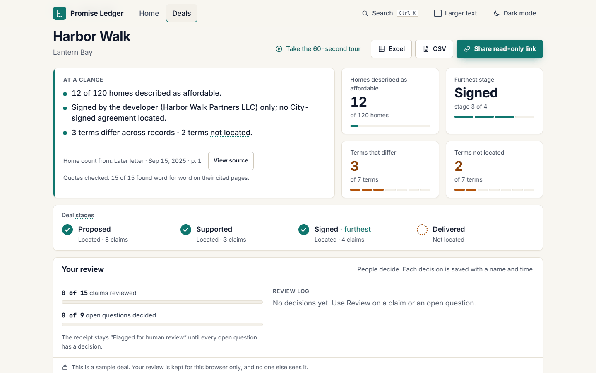
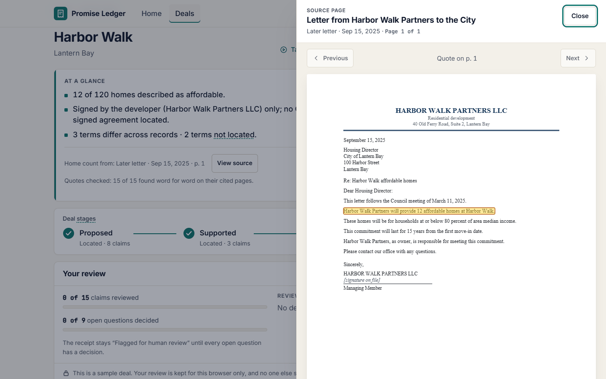
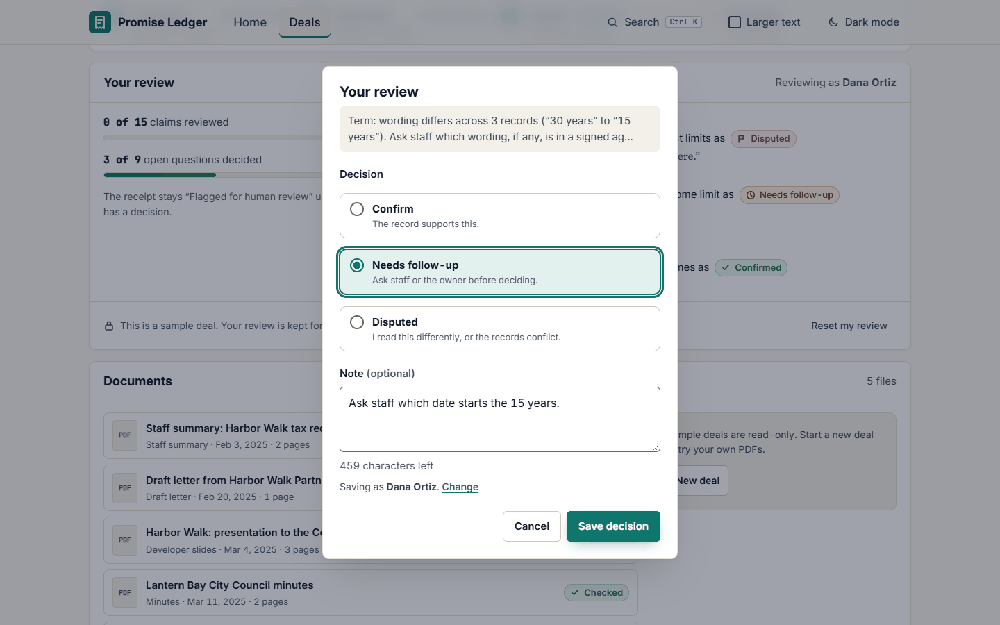
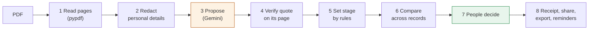
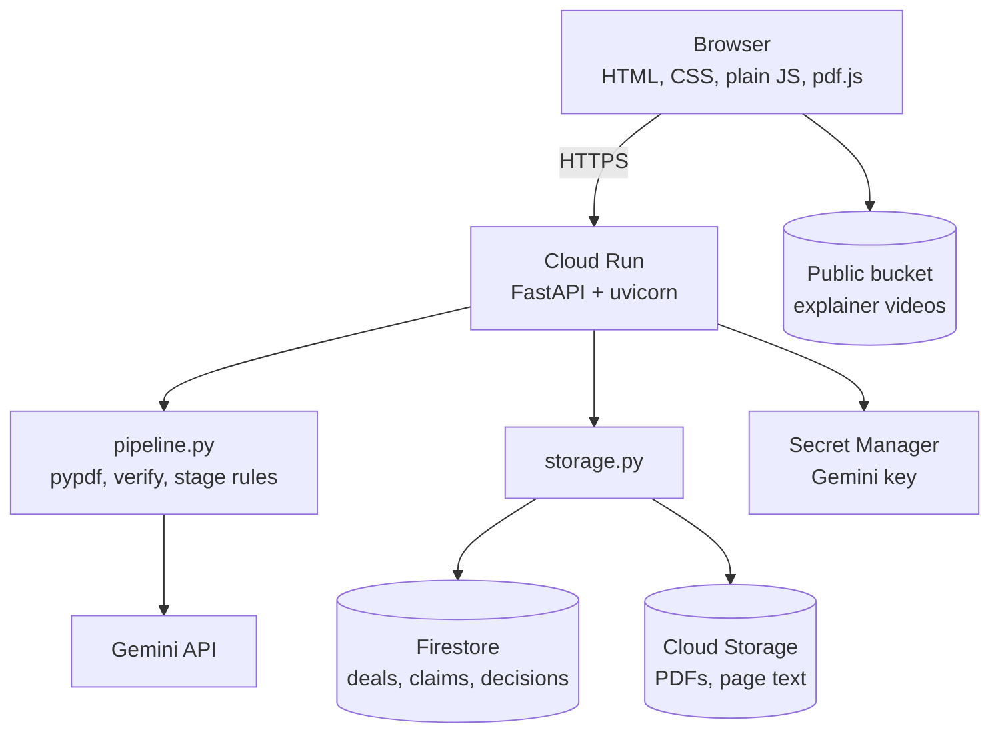

# Promise Ledger: the complete guide

Source-linked receipts for subsidized housing deals. **AI reads, code checks, people decide.**

| | |
|---|---|
| **Live demo** | https://promise-ledger-1071927289312.us-central1.run.app (short link: https://promise-ledger.web.app) |
| **Start here** | Open *Harbor Walk*, then press **Take the 60-second tour** |
| **Built for** | GDG AI for Good 2026: Housing. First submission Nov 9, 2026; final Dec 2, 2026 |
| **Team** | Mukul Rayana and Karthik Ramanathan (a two-person student team) |
| **License** | Code Apache-2.0; docs and evaluation data CC BY 4.0 |
| **Data** | Every deal, city, company, person and number in the demo is made up |

## Contents

1. [In one minute](#1-in-one-minute)
2. [The problem](#2-the-problem)
3. [Who it is for, and when it helps](#3-who-it-is-for-and-when-it-helps)
4. [A walk through the product](#4-a-walk-through-the-product)
5. [How it works: the pipeline](#5-how-it-works-the-pipeline)
6. [The AI: models, prompts and cost](#6-the-ai-models-prompts-and-cost)
7. [Architecture and stack](#7-architecture-and-stack)
8. [Data model](#8-data-model)
9. [Evaluation](#9-evaluation)
10. [Safety, privacy, fairness and accessibility](#10-safety-privacy-fairness-and-accessibility)
11. [Running, deploying and operating it](#11-running-deploying-and-operating-it)
12. [API reference](#12-api-reference)
13. [Testing](#13-testing)
14. [What is new here](#14-what-is-new-here)
15. [Limits and roadmap](#15-limits-and-roadmap)
16. [Glossary](#16-glossary)

---

## 1. In one minute

When a housing project gets a tax break or other public support, the developer promises affordable homes in return. Those promises are spread across many records: a staff report, a letter, slides for the council, the minutes of the vote, a signed agreement and, years later, compliance certificates. The wording drifts between them, and nobody holds the whole picture.

Promise Ledger reads a deal's PDFs and builds **one checked receipt**:

- **every promise** (how many homes, for whom, for how long, who is responsible, how it is reported, what happens on default);
- **the exact quote and page** that says so, one click from the real PDF page;
- **how far each promise got**: proposed, supported, signed or delivered;
- **what changed** between records, and **what is missing**;
- **people's decisions** on each open question, with a name, a note and a time.

<p align="center"></p>

## 2. The problem

- **Promises outlive the people who made them.** Affordability terms run for 15 to 30 years or more. Staff change, files move, and the original commitment is hard to find.
- **Oversight is known to be weak.** Portland's City Auditor found oversight of housing tax abatements "inadequate to ensure program goals", with too little done to confirm that owners delivered the public benefits they promised ([Report #362, July 2008](https://efiles.portlandoregon.gov/record/3754034/file/document)).
- **The stakes are large.** Harvard's Joint Center for Housing Studies counted over 2 million federally assisted rental homes whose affordability contracts or restrictions were due to end between 2014 and 2024 ([JCHS](https://www.jchs.harvard.edu/blog/with-more-than-2-million-units-at-risk-how-can-the-u-s-preserve-its-affordable-rental-housing-stock)).
- **Checking by hand is slow.** In our Harbor Walk sample, checking 7 terms across 5 records is 35 look-ups before anyone compares them, and the income limit and term quietly change between records.

## 3. Who it is for, and when it helps

| Person | Their question | What Promise Ledger shows |
|---|---|---|
| **Council aide**, before a vote | "Is what the developer signed what the council was told?" | Harbor Walk: the staff summary said 60% of AMI for 30 years; the slides and the signed letter say 80% for 15 years. Only the developer has signed. Rent limits and remedies are in no record. |
| **Compliance officer**, years after signing | "Are the homes still protected, and is the paperwork in?" | Mill Street: 9 homes at 50% of AMI until Dec 31, 2026. The 2024 certificate is on file; the one due Mar 31, 2026 is not. A reminder says who to ask. |
| **Housing staff reviewer** | "Can I confirm this deal is in order, and move on?" | Beacon Point: all 7 terms match, signed by the City and the owner. Good news is stated as plainly as a gap. |
| **Residents and reporters** | "What was promised for this public money?" | A read-only receipt link with every quote and page. No account needed. |

## 4. A walk through the product

**Home.** The pitch, the proof numbers, eight captioned explainer videos (30 to 90 seconds each) and links to the sample deals and the tour.

**Deals.** A list of deals with their furthest stage, changed and missing terms, flags (one-party signing, missing certificate, term ending soon) and the next reminder.

**A deal page** has key figures at the top, the documents on file, and six tabs:

| Tab | What it holds |
|---|---|
| **Claims** | Each promise: exact quote, document, date, page, stage, wording, and "Quote found · p. N". **View source** opens the real PDF page with the quote highlighted. |
| **What changed** | Each term across records in date order, with removed words struck through and added words underlined. |
| **Open questions** | Every changed or missing term. Each needs a person to decide: **Confirm**, **Needs follow-up** or **Disputed**, with a note. |
| **Receipt** | One printable page. A stamp states the outcome: "Flagged for human review", "Review in progress" or "Review complete", with the last reviewer and date. |
| **Read new text** | Paste up to 4,000 characters; candidate quotes come back, each checked word for word. Nothing is stored. |
| **Glossary** | Plain explanations of AMI, PILOT, regulatory agreement and the stage names. |

<p align="center"> </p>

**Also:** a 60-second guided tour, a read-only share link (`/r/{token}`), Excel and CSV export with a preview, reminders for term ends and yearly certificates, search (Ctrl K), dark mode, a larger-text mode, and About and Roadmap pages.

**Starting a new deal:** name it, drop in PDFs, and watch each one move from *Reading* to *Checked*. On the public demo, sample deals are read-only and visitor uploads are deleted after 24 hours.

## 5. How it works: the pipeline



Only step 3 uses AI. Every other step is plain code or a person.

1. **Read pages.** pypdf extracts the text of each page in a separate process, stopped after 15 seconds. Pages with no text layer are flagged as scanned and become open questions. Limits: 20 MB, 60 pages, no password.
2. **Redact.** ID numbers, emails and phone numbers are removed before any text leaves the server.
3. **Propose.** Gemini receives the page-tagged text (`<page n="1">…</page>`) and returns, in a fixed schema: the document type, title, date, whether it is a draft, each completed signature line, and candidate quotes with their term, page, wording and value.
4. **Verify.** Code checks every quote against the page text, word for word (whitespace, quote marks and dashes normalized). A quote found on another page gets its page corrected. A quote found nowhere is dropped. Headers, footers, self-descriptions, "term is missing" sentences and duplicates are set aside, and each document's counts show why.
5. **Set stage.** Code rules, never the model alone:

   | Stage | Set when |
   |---|---|
   | **Proposed** | Staff reports, slides, unsigned letters |
   | **Supported** | Minutes or resolutions with a recorded vote or approval, and staff recommendations |
   | **Signed** | An agreement or letter with a completed signature line under the party's name, not marked draft. If only the developer signed, it is flagged "signed by the developer only" |
   | **Delivered** | Certificates with occupancy or certification wording |

6. **Compare.** For each of the 8 terms, code reads a comparable value from the quote (home count and whether it is flat, a cap or a share; years or end date; percent; report due date; cure days) and marks **Wording differs** or **Not located**.
7. **Decide.** People record Confirm, Needs follow-up or Disputed on each open question. Decisions are append-only and never change a claim, term or stage.
8. **Output.** Receipt, share link, Excel and CSV export, and reminders computed from signed term and reporting clauses.

**The 8 terms:** homes, income limit, rent limits, term, responsible party, reporting, remedies, public support.

## 6. The AI: models, prompts and cost

| | |
|---|---|
| **Provider** | Google Gemini through the `google-genai` SDK |
| **Main model** | `gemini-3.5-flash` (set by `GEMINI_MODEL`) |
| **Fallback** | `gemini-flash-lite-latest`, tried once if the main model is busy, out of quota or times out |
| **Saved readings behind the eval** | `gemini-flash-lite-latest` for 9 PDFs and `gemini-3.8-flash` for 2 |
| **Output** | Structured output: a pydantic schema (`PdfReading`) passed as `response_schema`, at temperature 0 |
| **Caching** | Each reading is saved by file hash and prompt version, so a file is never paid for twice |
| **Without a key** | The app runs on saved readings and says so |

**What the prompt asks for:** the document type, title, date and draft flag; completed signature lines copied word for word; and at most a fixed number of candidate quotes, each one sentence copied word for word from one page, filed under one term.

**What the prompt forbids:** judging whether anything was approved, signed or delivered beyond what is asked. Text inside the record is data, and any instructions in it are ignored. A test confirmed an injected instruction was ignored.

**Why AI is needed:** promises are phrased in many ways ("set aside", "reserve", "workforce homes", "10 percent of the 120 homes"), across very different record types. Fixed patterns miss them. **Why AI is not trusted alone:** a model once attached a council vote to an unsigned draft letter, which made an offer look approved. Since then, the model only proposes and code decides.

**Cost:** about $0.002 per sample PDF; all 11 sample PDFs cost about $0.026. Sample PDFs are 1 to 4 pages, so longer packets cost more.

## 7. Architecture and stack



| Layer | What we use |
|---|---|
| Language | Python 3.12 (3.10+ supported) |
| Web | FastAPI, uvicorn, pydantic, python-multipart |
| PDFs | pypdf (text), pdf.js (viewer, vendored), reportlab (sample PDFs) |
| AI | Gemini via google-genai |
| Storage | Firestore (Native) and Cloud Storage, or local JSON files |
| Exports | openpyxl |
| Hosting | Docker on Google Cloud Run, Secret Manager, short link through Firebase Hosting |
| Front end | One HTML page, plain JavaScript and CSS, no framework, no build step |

**Code map**

| File | Role |
|---|---|
| `app/main.py` | Routes, share pages, media, health |
| `app/pipeline.py` | Read pages, verify quotes, stage rules, compare values |
| `app/ai.py` | The only module that calls the model; prompts, schemas, fallback, caching |
| `app/deals.py` | Deals, uploads, background reading, review, reminders, export |
| `app/ledger.py` | The hand-reviewed Harbor Walk packet and its checks |
| `app/guard.py` | Demo guard: rate limits, clean-up, security headers |
| `app/identity.py` | Who is acting; one seam for real sign-in later |
| `app/storage.py` | Local or Google Cloud storage behind one interface |
| `app/static/` | `index.html`, `app.js`, `style.css`, `pdfview.js`, `mock.js` |
| `tools/make_samples.py` | Builds the made-up sample PDFs |
| `evals/` | Gold answers and scoring scripts |

## 8. Data model

| Record | Key fields |
|---|---|
| **Deal** | id, name, city, developer, documents, `as_of` date, `demo` flag |
| **Document** | id, type, title, date, page count, `signed_by`, stage, status (reading, done, failed), counts of kept and set-aside quotes |
| **Claim** | quote, document, page (and stated page), topic, stage, wording, value, compare value, `verified` |
| **Term** | one of the 8 terms, its values across records, differs or not located |
| **Decision** | item, choice (confirm, follow up, disputed), note, reviewer name, time; append-only |
| **Share link** | token, deal; read-only |

A document record carries its own verified claims, so re-reading one document replaces only that document's claims.

## 9. Evaluation

**Method.** `python evals/run_pdf_evals.py` scores the pipeline against hand-labeled gold answers for 3 sample deals (11 PDFs, 53 claims). Each gold claim has its term, exact quote, file, page and stage, plus which terms should differ or be missing.

| Measure | Result |
|---|---|
| Precision / recall | 96.3% / 98.1% |
| Correct page cited | 100% |
| Correct stage | 100% |
| Incorrect "signed" or "delivered" | 0 |
| Changed and missing terms | exact on all 3 deals |
| Model cost | about $0.026 for all 11 PDFs |

Re-run on Nov 8, 2026; the numbers reproduce.

**What these numbers don't show.** This is a development set: made-up deals we wrote and labeled ourselves, and the rules were tuned on it. A claim counts as matched when its quote overlaps the labeled quote. It is not a held-out test, and there are no real records, scans or long packets in it yet. Before Dec 2 we will add a held-out set labeled blind and at least one real public record, and report them separately.

## 10. Safety, privacy, fairness and accessibility

**Grounding**
- No quote on the page, no claim. Stages come from rules, not the model.
- Every claim shows its exact quote, document type, date and page.
- Every receipt ends: a review records people's decisions; it is not a legal finding.

**Fairness.** A wrong "differs" could embarrass a developer or a staff member in public. So labels stay neutral ("wording differs", "not located", "flagged for human review"), clean deals say so plainly, and a person decides every item.

**Privacy**
- Only redacted page text reaches the model. The redactor catches ID numbers, emails and phone numbers, not names or addresses, so the demo asks for made-up records only.
- Pasted text is not stored or logged. Visitor uploads are deleted after 24 hours.
- A real deployment should use the paid Gemini API or Vertex AI, whose terms don't use prompts to train models.

**Public demo guard**
- Visitor deals belong to that browser's session; others get 404.
- Rate limits per network: 5 uploads, 3 new deals, 20 share links, 30 pasted-text readings and 120 exports an hour.
- Security headers: a Content Security Policy with scripts only from this site, `nosniff`, `Referrer-Policy`, no framing. The container runs as a non-root user with pinned dependencies.

**Accessibility**
- Keyboard throughout, visible focus, skip link, native dialogs that return focus.
- 4.5:1 contrast in light and dark, larger-text mode, reduced motion, forced colors, print styles.
- Captions on every video. A full screen-reader pass is still to do.

## 11. Running, deploying and operating it

**Run locally** (no API key needed):

```bash
python -m venv .venv
.venv\Scripts\activate          # macOS/Linux: source .venv/bin/activate
pip install -r requirements.txt
uvicorn app.main:app --reload --port 8080
```

**Deploy to Cloud Run:**

```bash
gcloud run deploy promise-ledger --source . --region us-central1 --allow-unauthenticated \
  --no-cpu-throttling \
  --set-env-vars STORAGE=gcp,GCS_BUCKET=YOUR_BUCKET,PUBLIC_BASE_URL=https://YOUR-SERVICE.run.app \
  --set-secrets GEMINI_API_KEY=gemini-api-key:latest
```

Uploads are read on a background thread, hence `--no-cpu-throttling`. Health check: `/api/health`. The full list of settings is in the [README](../README.md#deploy-cloud-run).

**Short link.** `promise-ledger.web.app` is a Firebase Hosting redirect (302) to the Cloud Run URL. It keeps the path and the `#/…` part, so `promise-ledger.web.app/#/deals/harbor-walk` works. No code change is needed, and rate limits still see each visitor's own address because traffic is not proxied.

**Running cost.** Cloud Run scales to zero when idle. A demo of this size fits in the Firestore, Cloud Storage and Firebase Hosting free tiers. Model cost is about $0.002 per short PDF, cached by file hash.

## 12. API reference

| Endpoint | What it does |
|---|---|
| `GET/POST /api/deals` | List deals, or create one `{name, city}` |
| `GET /api/deals/{id}` | A deal and its documents |
| `POST /api/deals/{id}/documents` | Upload a PDF (202); poll the deal until done |
| `POST …/documents/{doc}/retry` | Read a failed document again |
| `GET /api/deals/{id}/review` | Claims, stages, terms, open questions, decisions, receipt |
| `GET …/documents/{doc}/file`, `…/pages/{n}` | The PDF, and one page's text |
| `GET/POST/DELETE /api/deals/{id}/decisions` | Read, record or reset decisions |
| `GET /api/deals/{id}/export.xlsx`, `.csv`, `.json` | Exports |
| `POST /api/deals/{id}/share` | Create a read-only link `/r/{token}` |
| `GET /api/reminders` | Term ends and certificates due |
| `POST /api/extract` | Read pasted text; nothing stored |
| `GET /api/media` | Which explainer videos are present |
| `GET /api/health` | Health check |

Visitor requests carry an `X-Demo-Session` header (a random id the browser keeps); decisions also send `X-Reviewer-Name`.

## 13. Testing

```bash
python -m unittest discover -s tests -t .   # 258 tests
python -m app.ledger                        # every demo quote is on its cited page
python evals/run_pdf_evals.py               # score the pipeline (cached; at most 30 live calls)
```

The 14 test files cover the API, deals, decisions, the demo guard, hardening (sandbox, limits, headers), stage rules, sample PDFs and gold quotes, the interface's rules (no record text inserted as HTML, neutral wording, reduced motion, video captions) and the About and Roadmap pages.

## 14. What is new here

Each piece exists somewhere. We found no tool that combines them.

| Kind of tool | Examples | What it lacks for this job |
|---|---|---|
| Meeting search and summaries | Hamlet, CivicSearch, CityMeetings.nyc, Councilmatic | No promise tracking, quote checks or stages |
| Housing and subsidy databases | NHPD, Furman CoreData, Good Jobs First | Property-level fields; no source quotes or record-by-record checks |
| Contract AI | Ironclad, Agiloft | One contract at a time; no civic stages or comparison across record types |
| Compliance portals | Procorem and owner-side LIHTC tools | Logs and tasks, no AI reading of deal promises |

**What sets Promise Ledger apart:** it follows **the same promise across every record of one deal**, keeps it only if **the quote is on the page**, gives each record **a stage**, shows **where the wording changed**, and keeps **a named decision on each item**.

We avoid saying "first" or "only": our search was limited, and parts of this exist elsewhere.

## 15. Limits and roadmap

**Known limits today:** text-layer PDFs only (scans are flagged, not read); English only; the redactor misses names and addresses; reviewer identity is a typed name, not a sign-in; accuracy is measured on our own development set.

| Live today | By the Dec 2 final | After |
|---|---|---|
| Reads every PDF in a deal’s packet | Upload assistant that reviews records with you and names what is missing | Drafts records requests and follow-up letters for staff to approve |
| Quotes checked word for word on their pages | Ask a deal, for staff and for residents: answers only from checked quotes | Alerts before a term ends |
| Pages corrected; unverifiable quotes dropped | Ask and listen by voice | Spanish and other languages |
| Stages set by rules, from proposed to delivered | Reads scanned pages | Plain-language view for residents |
| One-party signing flagged | Accuracy on records it was never tuned on | More cities, and a kit to run it in-house |
| What changed, with word-level edits | A real public record, end to end |  |
| Missing terms and certificates found | Feedback and a timed task with housing staff |  |
| Reminders for term ends and certificates |  |  |
| Reviewer decisions with name, note and time |  |  |
| Printable receipt with a review stamp |  |  |
| Read-only share links for residents |  |  |
| Excel and CSV export with a preview |  |  |
| Guided tour and 8 captioned explainers |  |  |
| Redaction, injection guard, sandboxed PDFs |  |  |
| Runs without a key; about $0.002 per PDF |  |  |
| Keyboard, contrast, larger text, dark mode |  |  |

**One rule for every assistant:** it answers only from checked quotes, shows the page, and a person approves anything it sends or saves.

## 16. Glossary

| Term | Meaning |
|---|---|
| **Deal** | Public support for one housing development (a tax abatement, PILOT, grant or land sale) and the affordable-housing commitments made in return. Not a home for sale or rent. |
| **AMI** | Area median income. "60% of AMI" means homes for households earning at most 60% of the local median. |
| **PILOT** | Payment in lieu of taxes: a deal where an owner pays a set amount instead of normal property tax. |
| **Regulatory agreement** | The signed contract that binds an owner to the affordability terms. |
| **Compliance certificate** | A yearly statement from the owner that the terms were met. |
| **Proposed / Supported / Signed / Delivered** | How far a promise got: offered, backed by a vote, signed by the parties, shown as met. |
| **Wording differs** | The same term has different values in different records. |
| **Not located** | No record on file states the term. |
